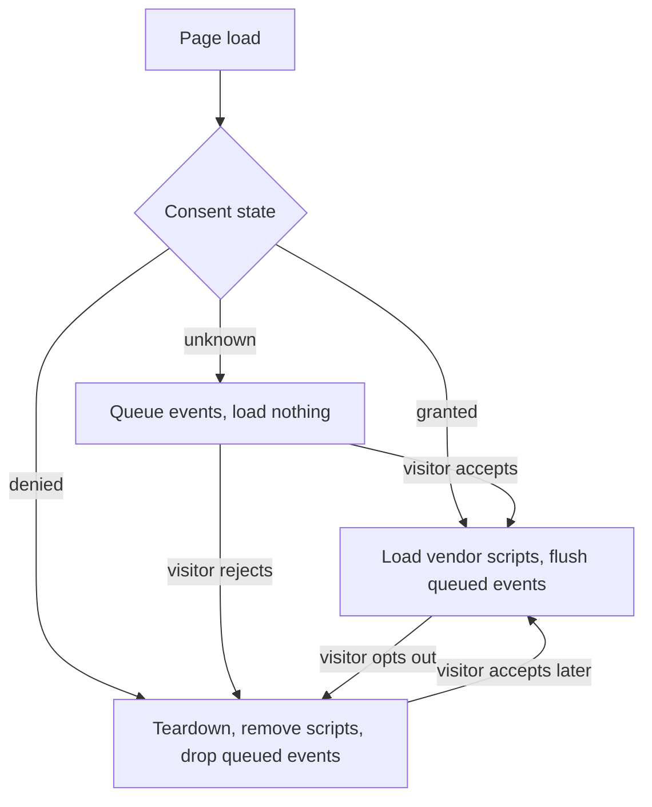

# consent-gated-tracking

A tiny browser library that keeps marketing and analytics scripts from loading until a consent signal says yes, and shuts them down when the visitor opts out. It also records first-touch campaign attribution (UTM parameters and ad click ids).

[](https://github.com/agugentile/consent-gated-tracking/actions/workflows/ci.yml)

Live demo: [https://agugentile.github.io/consent-gated-tracking/demo/](https://agugentile.github.io/consent-gated-tracking/demo/)

## Why this exists

Sites that use a consent manager often start vendor pixels before the visitor has answered, or leave them running after an opt-out. The cause is usually ordering: the tag is hard-coded in the page, the consent signal arrives later, and nothing connects the two. This library puts one small gate in between. Nothing loads while consent is unknown or denied, events wait in a queue until the answer is known, and an opt-out removes the scripts and drops anything still waiting.

It has no runtime dependencies, no build step, and is a few hundred lines of plain ES modules.

## How it works



- Only `granted` loads anything. A missing or unrecognized state from your adapter is treated as `unknown`.
- Moving from `granted` back to `unknown` also shuts the vendors down. Only `denied` drops the queue and clears stored attribution.
- A vendor that loads again after an opt-out gets a fresh script tag. Nothing is reused.

## Quick start

The package is not on npm yet. Install it from GitHub, or copy the `src/` folder into your project.

```sh
npm install github:agugentile/consent-gated-tracking
```

```js
import { init, track } from 'consent-gated-tracking';

// 1. Wrap your consent manager in the two-method adapter.
const consent = {
  getState() {
    const choice = window.consentManager.getChoice('marketing'); // your manager's own API
    if (choice === undefined) return 'unknown';
    return choice ? 'granted' : 'denied';
  },
  subscribe(callback) {
    window.consentManager.on('change', callback);
    return () => window.consentManager.off('change', callback);
  },
};

// 2. Describe your vendors. None of this runs until consent is granted.
init({
  consent,
  vendors: [
    {
      id: 'ad-pixel',
      src: {
        prod: 'https://cdn.example.com/pixel.js',
        qa: 'https://cdn.example.com/pixel.qa.js',
      },
      integrity: { prod: 'sha384-...', qa: 'sha384-...' }, // optional
      onEvent: (event) => window.adPixel.push(['track', event.name, event.props, event.attribution]),
      teardown: () => {
        delete window.adPixel;
      },
    },
  ],
});

// 3. Track events. They are held, sent, or dropped depending on consent.
track('signup_started', { plan: 'pro' });
```

An opt-out ("do not sell or share") is the state `denied`.

To try it without a consent manager, use `createMockAdapter()` and call `.grant()`, `.deny()` or `.reset()` yourself. The demo does exactly that.

### Environments

By default vendors load their `prod` script. Add `?env=qa` to any URL to load the `qa` script instead. The choice is kept in `sessionStorage` for the rest of the tab session, and `?env=prod` switches back. Anyone can add that parameter to a production URL, so pass `allowEnvSwitch: false` where that is not wanted.

### Attribution

On the first grant, the UTM parameters (`utm_source`, `utm_medium`, `utm_campaign`, `utm_term`, `utm_content`) and click ids (`gclid`, `fbclid`, `ttclid`, `msclkid`) in the landing URL are stored in `localStorage` for 30 days. Later visits do not overwrite them. After 30 days the next visit that carries parameters starts a new record. Every event delivered to a vendor has the stored values in `event.attribution`.

Attribution is not written before consent. The loader keeps what the landing URL carried in memory and stores it on grant.

## API

### Exports

| Export | What it does |
| --- | --- |
| `init(config)` | Creates a loader with `createLoader`, remembers it so `track` works anywhere, and returns it. Calling it again shuts the previous loader down first. |
| `track(name, props?)` | Tracks an event on the loader made by `init`. Returns `'queued'`, `'sent'` or `'dropped'`. Throws if `init` has not been called. |
| `createLoader(config)` | The loader itself, for when you do not want a shared instance. See below. |
| `createMockAdapter(initial?)` | A consent adapter you control by hand: `set(state)`, `grant()`, `deny()`, `reset()`. |
| `parseAttribution(url)` | Returns the UTM parameters and click ids found in a URL. |
| `getAttribution(options?)` | The stored first-touch attribution, or `{}`. |
| `saveAttribution(params, options?)` | Stores `params` unless a valid first touch exists. Returns what is in effect. |
| `captureAttribution(url, options?)` | `parseAttribution` followed by `saveAttribution`. |
| `clearAttribution(options?)` | Removes the stored attribution. |
| `resolveEnvironment(options)` | The environment logic on its own: URL, then session, then default. |
| `createMemoryStorage()` | An in-memory stand-in for `localStorage`, useful in tests. |

Attribution options: `storage` (localStorage-like, `null` for none), `ttlDays` (default 30), `key` (default `cgt_attribution`), `now` (clock).

### Consent adapter

| Member | Description |
| --- | --- |
| `getState()` | Returns `'granted'`, `'denied'` or `'unknown'`. |
| `subscribe(callback)` | Calls `callback` when the state changes. Returns an unsubscribe function. |

### `createLoader(config)`

| Option | Default | Description |
| --- | --- | --- |
| `consent` | required | A consent adapter. |
| `vendors` | `[]` | Vendor definitions, see below. |
| `env` | `'prod'` | Default environment, `'prod'` or `'qa'`. |
| `allowEnvSwitch` | `true` | Honor `?env=` in the URL. |
| `window`, `document` | globals | Injectable, so tests can use jsdom. |
| `storage` | `window.localStorage` | Where attribution is kept. |
| `sessionStorage` | `window.sessionStorage` | Where the environment choice is kept. |
| `attribution` | `{}` | `{ ttlDays, key }`. |
| `maxQueue` | `100` | Most events held while consent is unknown. The oldest is dropped first. |
| `onLog` | none | Called with `{ type, time, ... }` for everything the loader does. |
| `now` | `Date.now` | Clock, for tests. |

The loader returns `{ track(name, props), status(), getAttribution(), destroy() }`. `status()` gives `{ state, env, queued, vendors }`, where each vendor is `idle`, `loading`, `loaded` or `failed`.

### Vendors

| Field | Description |
| --- | --- |
| `id` | Unique string. Also set on the script tag as `data-consent-vendor`. |
| `src` | A URL string, or `{ prod, qa }`. |
| `integrity` | Optional Subresource Integrity hash, as a string or `{ prod, qa }`. The tag also gets `crossorigin="anonymous"`. |
| `crossorigin` | Optional override for the `crossorigin` attribute. |
| `onLoad({ env, src })` | Called when the script has loaded. |
| `onEvent(event)` | Called with `{ name, props, time, attribution }`. Events wait until this vendor's script has loaded. |
| `teardown({ env })` | Called when consent is withdrawn (denied, or back to unknown). Undo what the vendor set up. |

A vendor hook that throws is reported through `onLog` and does not stop the others.

### Log entries

`consent`, `vendor-loading`, `vendor-loaded`, `vendor-error`, `vendor-teardown`, `vendor-removed`, `queued`, `flushed`, `sent`, `dropped`.

## Things to know

- This controls when scripts load. It does not decide what you may collect, and it does not replace a consent manager. Check the rules that apply to your site.
- A hard-coded tag in your HTML or tag manager bypasses all of this. The vendors you list here have to be removed from the page source.
- A script request that is already in flight cannot be cancelled. The loader removes the tag and, if the script still arrives, runs `teardown` as soon as it does.
- Removing a script tag does not undo what the script already did. Cookies, globals and listeners need to be cleaned up in the vendor's `teardown`.
- Attribution is read from the URL the page loaded with. If the visitor navigates before answering, or the URL changes without a reload, the parameters are not seen.
- Denial clears stored attribution, so the next visit that carries parameters becomes the new first touch.
- Events held while consent is unknown live in memory only. They are lost if the page unloads first.

## Run the demo locally

The demo uses ES modules, which browsers do not load from `file://`. Serve the repository root with any static server and open `/demo/`:

```sh
python3 -m http.server 8080
# then open http://localhost:8080/demo/
```

## Development

```sh
npm install
npm test
npm run lint
```

Needs Node 20 or later. Tests use `node:test` and jsdom, and CI runs them on Node 20 and 22. jsdom does not download scripts, so the tests fire the `load` and `error` events by hand.

## What I would add next

- A Global Privacy Control adapter that maps `navigator.globalPrivacyControl` to `denied`.
- Consent categories (analytics, advertising) so a vendor can declare which one it needs, instead of one switch for everything.
- Adapters for a few common consent managers.
- A `sessionStorage`-backed queue so events survive a page navigation while consent is still unknown.
- Reading attribution again on client-side route changes.
- A per-vendor list of cookies to delete on opt-out.
- Type definitions.
- Browser tests with real script loading, including a failed integrity check.
- Publishing to npm.

## License

MIT. See [LICENSE](LICENSE).
